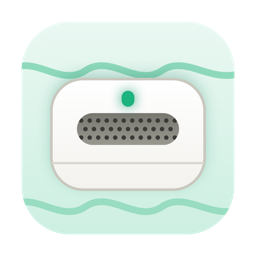

<p align="center"></p>

# AirGlance – menu-bar dashboard for Amazon air quality monitors

AirGlance is a small macOS menu-bar app that shows the readings of your **Amazon Smart Air Quality Monitor**
(score, PM2.5, PM10, VOC, carbon monoxide, temperature, humidity) with traffic lights, history
charts and notifications – without opening the Alexa app on your phone.

> **Unofficial project.** Not affiliated with, endorsed or supported by Amazon. "Amazon", "Alexa"
> and "Echo" are trademarks of Amazon.com, Inc. The app uses the same *undocumented* Alexa web API
> as the Alexa website and the Home Assistant integration
> [alexa_media_player](https://github.com/alandtse/alexa_media_player). Amazon can change or block
> it at any time, and automated access may conflict with Amazon's
> [Conditions of Use](https://www.amazon.com/gp/help/customer/display.html?nodeId=GLSBYFE9MGKKQXXM).
> Use it only with your own account and at your own risk. **Status: beta.**

> **Not a safety device.** The monitor and this app are no substitute for a certified
> carbon-monoxide or smoke alarm. Thresholds shown are general guidance, not medical advice.

## Features

- Menu-bar icon shaped like the monitor; its status light uses the device's LED colours: green / yellow / red for the air quality, purple = no current data, blue = login or setup needed – click for the dashboard
- Live values with a small 6-hour trend per tile and an explanation on hover
- Collapsible history (24 h / 7 days / 30 days) with coloured comfort zones
- Imports the history Amazon has stored (5-minute resolution) – no gap when you start the app later
- macOS notifications in plain language when a value changes its traffic-light state
  ("Too warm – 25.3 °C …"), when the monitor goes offline or the Amazon login expires
- Several monitors: choose which ones to show and give them your own names
- Setup assistant (account → Amazon login in your browser → find monitors)
- Start at login, works after sleep/wake, everything stays on your Mac

UI language: German (English is planned).

## Requirements

- macOS 13 or later on Apple Silicon
- An Amazon account with the air quality monitor set up in the Alexa app
- To build: Xcode Command Line Tools (`xcode-select --install`) and an internet connection for the first build.
  No Python installation needed – the app ships its own.

## Install (build it yourself)

```bash
git clone https://github.com/mrfloppi/airglance.git
cd airglance
./build-app.sh
open ~/Applications/AirGlance.app
```

`build-app.sh` compiles the Swift app, embeds a self-contained Python 3.15.2
([python-build-standalone](https://github.com/astral-sh/python-build-standalone), pinned and verified by SHA-256,
cached in `build/cache/`), installs the dependencies into it, signs the app ad-hoc (needed for
notifications) and installs it to `~/Applications`. The finished app (~130 MB) runs on any Apple-Silicon Mac
without Homebrew or Python. Run the script again after updating the code.

On first start the dashboard guides you through:

1. **Account** – e-mail address and Amazon store (e.g. amazon.de, amazon.com)
2. **Login** – opens Amazon's own login page in your browser (see *How login works*)
3. **Monitors** – the app looks up all air quality monitors in your Amazon account; pick and name them

The monitors are found through your Amazon account. They offer no local network interface.

## Usage

- **Left click** the menu-bar icon: open/close the dashboard
- **Right click**: open in a window, monitors & account, notifications on/off, test notification,
  start at login, log file, data folder, sign out, quit
- **Gear icon** in the dashboard: the same settings, grouped like macOS System Settings

## How login works – and what is stored

- The app starts a small local proxy (`127.0.0.1:8765`, only while you log in, max. 15 minutes)
  that forwards Amazon's login page to your browser (via [authcaptureproxy](https://github.com/alandtse/auth_capture_proxy)).
  You type your password and 2FA code on Amazon's page. They pass through this local process
  but are **never stored**.
- Stored afterwards (readable only by your macOS user, `chmod 600`): session cookies and OAuth
  tokens so the app can refresh the session.
- Everything stays local: `~/Library/Application Support/AirGlance/`
  (`.auth/` login, `data/aqm.db` readings, `settings.json` monitors & names, `logs/server.log`).
- No telemetry, no third-party servers – the app only talks to Amazon.
- The local dashboard server listens on `127.0.0.1:47823` only, rejects other host names
  (DNS-rebinding protection) and requires a custom header for all changes (CSRF protection).

## Uninstall

Quit the app (right click → *AirGlance beenden*), then:

```bash
rm -rf ~/Applications/AirGlance.app
rm -rf ~/Library/Application\ Support/AirGlance
```

If you enabled *start at login*, turn it off first (or remove it in System Settings → General → Login Items).

## Thresholds

| Value | Good | Moderate | Source |
|---|---|---|---|
| Air quality score | 65–100 | 35–64 | reported by the device |
| PM2.5 | ≤ 12 µg/m³ | ≤ 35 µg/m³ | US EPA guidance |
| PM10 | ≤ 54 µg/m³ | ≤ 154 µg/m³ | US EPA guidance |
| VOC index | ≤ 30 | ≤ 60 | **estimated** – Amazon publishes no thresholds |
| Carbon monoxide | ≤ 9 ppm | ≤ 35 ppm | WHO / US EPA |
| Temperature | 19–24 °C | 17–26 °C | common comfort range |
| Humidity | 40–60 % | 30–70 % | common indoor recommendation |

They are defined once in `server.py` (`GOOD_RANGE`, `MODERATE_RANGE`).

## Known limitations

- Unofficial API – may break when Amazon changes something (login is the most fragile part).
- PM10 history is not offered by Amazon; PM10 starts with the first live reading.
- Tested with amazon.de and a single monitor so far; other stores and multiple monitors should work but are untested.
- Apple Silicon only; signed ad-hoc and not notarized – a copy downloaded from the internet is blocked by
  Gatekeeper (right click → Open, or build it yourself). Notarized releases need an Apple Developer ID.
- `probe.py` patches an incompatibility between `authcaptureproxy` and `httpx ≥ 0.28`
  (multipart login forms); dependencies are pinned in `requirements.txt` for that reason.

## Project layout

| Path | What |
|---|---|
| `app/main.swift` | macOS app: menu-bar icon, popover/window (WKWebView), notifications, autostart, starts the backend |
| `server.py` | Python backend: Amazon login, polling, history import, SQLite, JSON API, dashboard server |
| `probe.py` | login helpers, file locations, httpx workaround; also a CLI to test the connection |
| `static/index.html` | dashboard UI (setup assistant, tiles, charts, settings) |
| `tools/explore.py` | developer tool to explore the Alexa GraphQL API |
| `tests/` | unit tests: `.venv/bin/python -m unittest discover -s tests -v` |
| `build-app.sh` | builds and installs the app |

### Development

```bash
python3.15 -m venv .venv && .venv/bin/pip install -r requirements.txt   # any Python 3.15 for development
.venv/bin/python -m unittest discover -s tests -v     # tests
.venv/bin/python probe.py                             # test login + print raw values (CLI)
.venv/bin/python server.py                            # backend only: http://127.0.0.1:8080
```

## Credits & licence

Built on [alexapy](https://gitlab.com/keatontaylor/alexapy) and
[authcaptureproxy](https://github.com/alandtse/auth_capture_proxy); the API knowledge comes from
[alexa_media_player](https://github.com/alandtse/alexa_media_player). Third-party licences:
[THIRD_PARTY_NOTICES.md](THIRD_PARTY_NOTICES.md).

This project: [MIT](LICENSE) © 2026 [mrfloppi](https://github.com/mrfloppi).

---

### Kurz auf Deutsch

AirGlance ist eine inoffizielle Menüleisten-App für den Amazon Smart Air Quality Monitor: Ampel in der Menüleiste,
Dashboard mit Verlauf, verständliche Mitteilungen, mehrere Monitore. Installation:
`./build-app.sh` (bringt sein eigenes Python mit). Nicht mit Amazon verbunden; nutzt eine
inoffizielle Schnittstelle, die Amazon jederzeit ändern oder sperren kann – Nutzung auf eigenes
Risiko und nur mit dem eigenen Konto. Kein Ersatz für einen CO- oder Rauchmelder.
